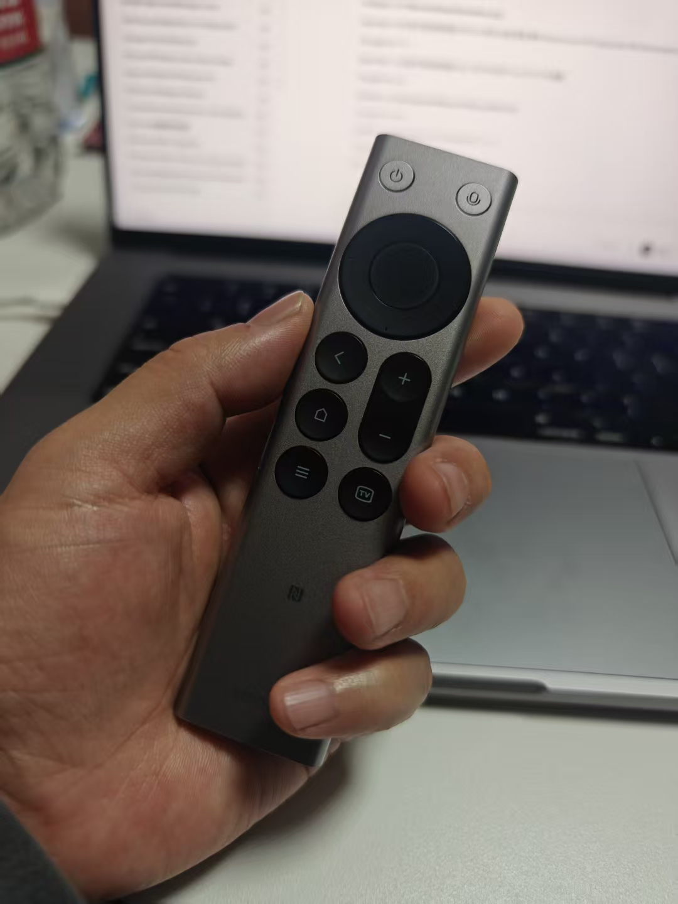
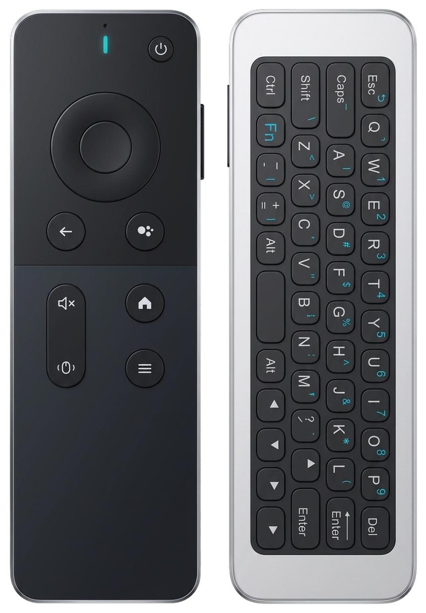

# 遥控器设备指南

更新日期：2026-11-14。本文记录 Remote Buddy **macOS 版**的设备型号、外观、按键、语音操作、限制和选购信息。Windows 支持另行验证。

## 先看语音键怎么按

这里的“需要一直按住”指**遥控器上的实体语音键**，不是电脑输入法的 Fn 触发设置。

| 设备与型号 | 是否需要一直按住语音键 | 当前支持情况 | 参考价格 |
| --- | --- | --- | --- |
| 小米蓝牙遥控器 2 Pro · `RC003` | **需要**；按住说话，松手停止收音 | 按键已本地验证，音频由用户确认正常；单次按住约 60 秒上限 | 中国大陆，小米有品页面参考 **¥99** |
| 小米蓝牙遥控器 2 · `RC001` | 按住说话；完整音频流程仍待单独验收 | 已有协议与按键适配，不能直接沿用 2 Pro 的全部验收结论 | 未核实 |
| T1 飞鼠键盘语音遥控器 · `T1-Remote` | **不需要持续按住**；按一下并松开开始，再按一下结束 | 作者蓝牙样机已验证；兼容批次需单独确认 | 中国大陆，项目样本记录约 **¥50**，非本次实时报价 |
| Chromecast Voice Remote · `G9N9N` | **需要**；全程按住 Google Assistant 语音键 | 语音可用；已测样机普通单键映射不可用，支持实验性双键 Enter | 原装未核实；兼容款有用户反馈 **¥15**，见下文 |
| Google TV Streamer Voice Remote · `GY3LE` | Remote Buddy **尚未支持**；原生电视用法为按住语音键 | 计划支持，未完成适配与真机验证 | 未核实 |
| Apple Siri Remote · 分代识别 | Remote Buddy **尚未支持** | 计划支持，未完成适配与真机验证 | 未按代际核实 |

价格、商品链接不代表兼容性认证。标价可能变化，运费、优惠和地区限制以结算页为准；未知信息保留“未核实”。

**切换输入法的触发方式，不会改变遥控器的收音方式。** 例如，G9N9N 松手后不再提供语音流，不能靠“点按开始/结束”设置或电脑上的虚拟麦克风让它继续收音。T1 的免持续按住来自已测样机松手后仍发送音频的行为，不能推广到其他遥控器。

## 小米蓝牙遥控器 2 Pro（RC003）

- **外观**：银灰色单面长条机身，正面圆形方向盘，底部 Type-C 充电口。上图为项目实拍。
- **主要按键**：电源、语音、方向与 OK、返回、主页、菜单、TV、音量加减。
- **语音操作**：按住语音键说话，松开停止收音。约 60 秒为当前记录中的单次按住上限；松手后还需等待尾音送完及输入法处理。
- **特点与限制**：适合短句输入和常用快捷键。电视 NFC 投屏等功能不属于本项目的 Mac 功能。
- **连接**：蓝牙直连 Mac。
- **价格与购买**：2026-11-14 核对的小米有品商品参考价为 **人民币 99 元**。[小米有品商品页](https://www.xiaomiyoupin.com/detail?gid=183179)；[小米商城商品页](https://www.mi.com/shop/buy/detail?product_id=1230804215)。商品名须为“蓝牙遥控器 2 Pro”，收货后再确认型号。
- **详细对比**：[小米 2 Pro 与 T1：实拍、尺寸与使用差异](xiaomi-2pro-vs-t1-remote.md)。

## 小米蓝牙遥控器 2（RC001）

- **型号**：`RC001` 对应“2”，不是 `RC003` 的“2 Pro”。购买和反馈时请提供完整型号。
- **外观与按键**：尚未补齐独立核验的实拍和逐键资料；不要用上面的 2 Pro 照片作为 RC001 的型号依据。
- **语音操作与支持**：已有 ATVV 语音和按键适配，按住说话的完整音频流程仍待单独验收。
- **价格与购买**：暂未录入已核对的报价和指定商品链接。检索时使用“小米蓝牙遥控器 2 RC001”，避免只按“支持小米电视”的商品标题购买。

## T1 飞鼠键盘语音遥控器（T1-Remote）

- **外观**：双面设计，正面方向盘和控制键，背面 QWERTY 小键盘；项目样机的 Type-C 与音量键位于侧面。示意图不代表所有贴牌批次。
- **主要按键**：7 颗可自定义的正面控制键为返回、主页、菜单、音量加、音量减、静音、电源。方向键、OK、背面键盘和空中飞鼠保持原生直通。
- **语音操作**：按一下语音键并松开，继续说话；说完再按一下结束。**不必持续按住**。
- **会话长度**：作者样机已实测连续口述近 2 分钟。程序每 10 秒保活，最长约 5 分钟后保护性结束；5 分钟是程序上限，不是所有批次均已实测通过的时长。
- **连接**：必须使用**蓝牙直连**；不要用 2.4 GHz USB 接收器模式判断本项目的语音兼容性。
- **价格与购买**：项目[实拍对比记录](xiaomi-2pro-vs-t1-remote.md)约 **人民币 50 元**，并非本次核实的现价。[淘宝检索入口](https://s.taobao.com/search?q=T1%20%E8%93%9D%E7%89%99%20%E9%A3%9E%E9%BC%A0%20%E8%AF%AD%E9%9F%B3)仅提供搜索，不指定已验证店铺。确认蓝牙语音版本、双面键盘和退换条件；相同外壳不保证同一固件。
- **验收依据**：[T1 真机调试记录](../docs/t1-remote-hardware-debugging.md)。

## Google Chromecast Voice Remote（G9N9N）

- **型号与外观**：`G9N9N`，圆润短机身，顶部方向盘，侧面音量键；示意图用于识别布局，不能证明商品原装或兼容。
- **主要按键**：方向与 OK、返回、Google Assistant、主页、静音、YouTube、Netflix、电源、输入源、侧面音量。[Google 官方按键说明](https://support.google.com/chromecast/answer/10116742?hl=en)。
- **语音操作**：**全程按住 Google Assistant 语音键**，松手停止提供语音流。在 Remote Buddy 中使用“按住说话”；[issue #175](https://github.com/zfdang/remote-buddy/issues/175)报告“点按开始/结束”不可用。当前不提供松手后持续收音或后台常开监听功能，不能把 T1 的保活能力套用过来。
- **按键限制**：项目已测样机的单键及松开报文存在长度问题，macOS 不转交普通单键；自定义按键不能按“小米或 T1 全键可用”理解。开启自定义按键并独占设备时，支持短按 OK＋任意方向键发送一次 Enter。详见[兼容性说明及测试条件](../docs/g9n9n-compatibility.md)。
- **供电**：两节 AAA 电池。没有本项目可承诺的统一续航数据；社区存在耗电较快的反馈，不能仅凭低功耗蓝牙名称推断续航。
- **原装价格与购买**：未录入核实报价；不要把下面兼容款的 15 元当作 Google 原装价格。

### 用户分享的兼容款：约 15 元

[issue #170 的用户反馈](https://github.com/zfdang/remote-buddy/issues/170#issuecomment-6846598354)记录：2026-11-13 在拼多多购买了约 **人民币 15 元**的兼容款，用户表示按键可识别，同时反馈电池消耗较快。

- **用户分享的购买链接**：[拼多多商品页](https://mobile.yangkeduo.com/goods.html?ps=wI005ehWCi)，来源为[用户原评论](https://github.com/zfdang/remote-buddy/issues/170#issuecomment-6847000702)。
- **核验状态**：本次无法直接访问商品页，未核验当前价格、店铺、库存或实际发货批次；这是用户样本报告，不是作者验收或店铺推荐。
- **语音方式**：评论中的“单击”没有验证“松手后持续收音”，不能据此认定该款支持免长按语音。
- **外观与型号**：尚无核实过的独立型号、固件和实拍。类似外壳或“兼容 G9N9N”的标题，不保证内部协议、按键和耗电表现一致。

项目已测样机的单键限制，与这个兼容款用户的按键成功反馈，属于不同样本，分别保留记录。

## Google TV Streamer Voice Remote（GY3LE，计划支持）

- **外观与按键**：与 G9N9N 布局不同；有方向与 OK、语音、返回、主页、音量、静音、YouTube、Netflix、电源和自定义键，支持电视端寻回响铃功能。[Google 官方说明](https://support.google.com/googletv/answer/15323195?hl=en)。
- **语音方式**：Google 电视端说明为按住 Assistant/Mic 键说话；**这不代表 Remote Buddy 已能使用它的麦克风**。
- **当前状态**：计划支持，未完成适配与真机验证；不能用 G9N9N 的测试结果替代。
- **价格与购买入口**：[Google Store 商品页](https://store.google.com/product/google_tv_streamer_remote?hl=en-US)。本次页面未提供可核实的价格；地区和库存以商店为准，不建议仅为本项目语音输入购买。

## Apple Siri Remote（计划支持）

- **型号与外观**：图示为第三代 USB-C `A2854`，铝色长条机身和圆形触控点击板；不代表所有代际布局。请按 [Apple 型号识别说明](https://support.apple.com/en-au/103233)确认，不能仅写“Siri Remote”。
- **主要按键**：图示型号含点击板/方向、返回、电视/控制中心、播放暂停、音量、静音、电源及侧面 Siri 键。见 [Apple 第三代规格](https://support.apple.com/en-us/111844)。
- **语音方式与当前状态**：Remote Buddy 尚未完成适配与真机验证，**暂不能作为本项目的语音输入设备**，因此不承诺 Mac 上的长按或点按方式。
- **价格与购买入口**：[Apple 在售 Siri Remote](https://www.apple.com/shop/product/mlfc4am/a/siri-remote)。在售产品可能已换代，不能将其价格或功能直接当作 A2854 的资料；当前不列混用代际的报价，也不建议仅为本项目购买。

## 补充设备记录

提交新设备或批次反馈时，请尽量提供：商品名和背标型号、固件、正反面/侧面实拍、连接方式、macOS 与应用版本，以及“按下—松手—再次按下”各阶段是否仍有语音。价格请注明币种、日期、店铺/商品链接，区分原装与兼容款。

设备图片复用项目实拍及[原创示意图](../Resources/RemoteIllustrations/README.md)，未复制厂商商品照片；示意图不按比例绘制，也不是兼容性证据。
