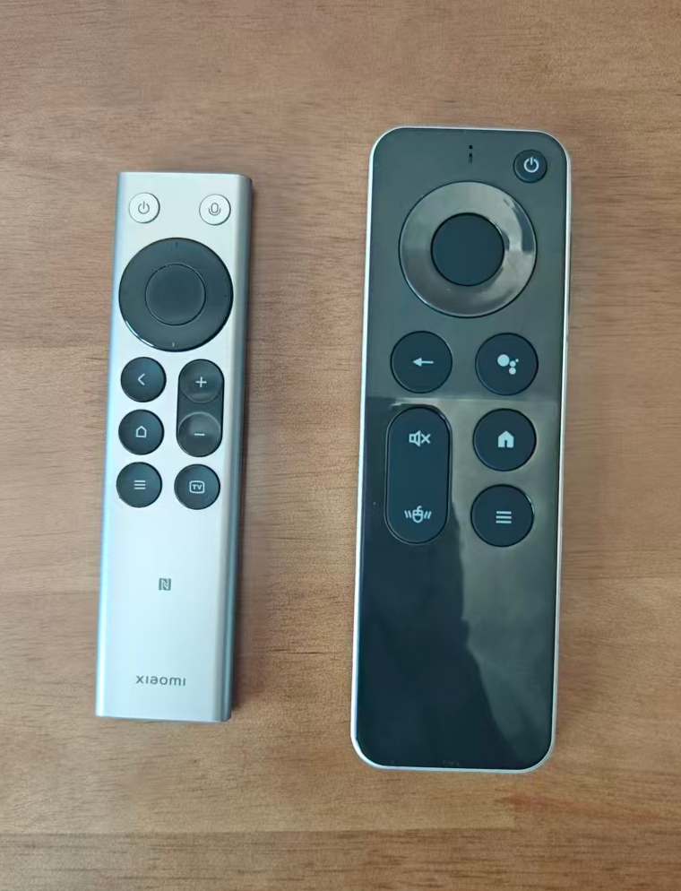
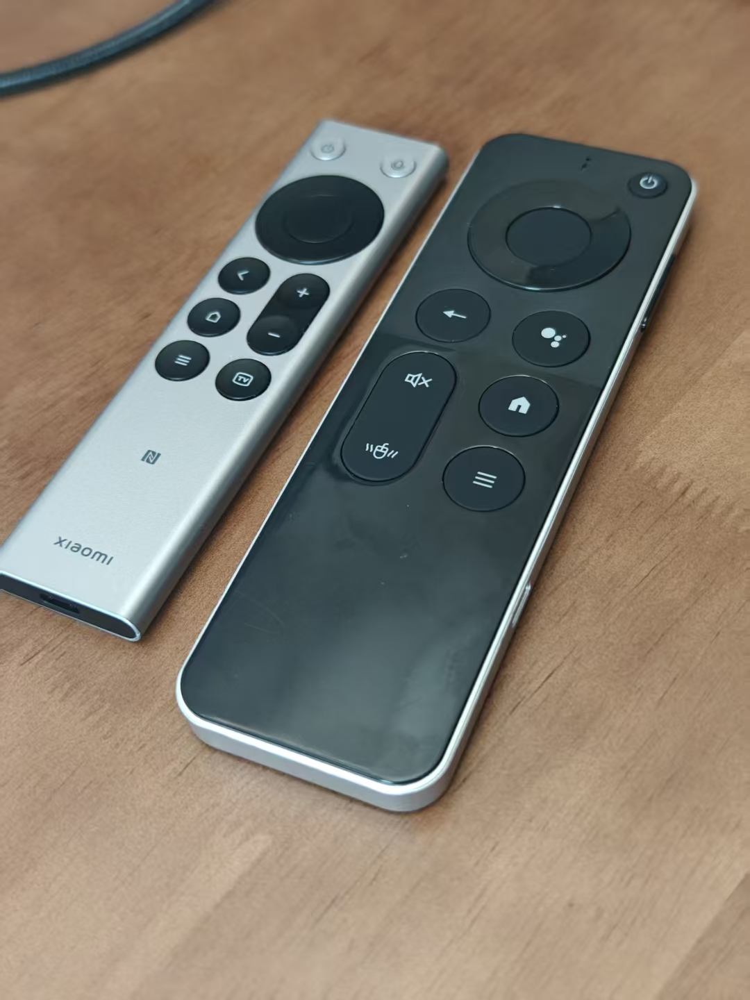
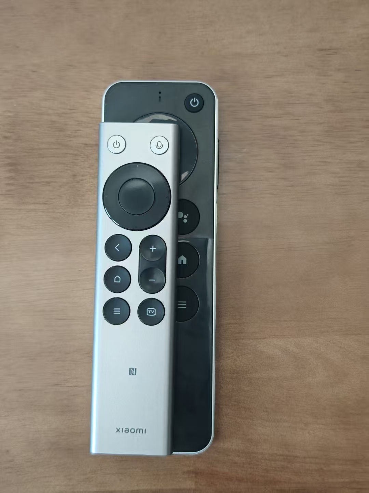
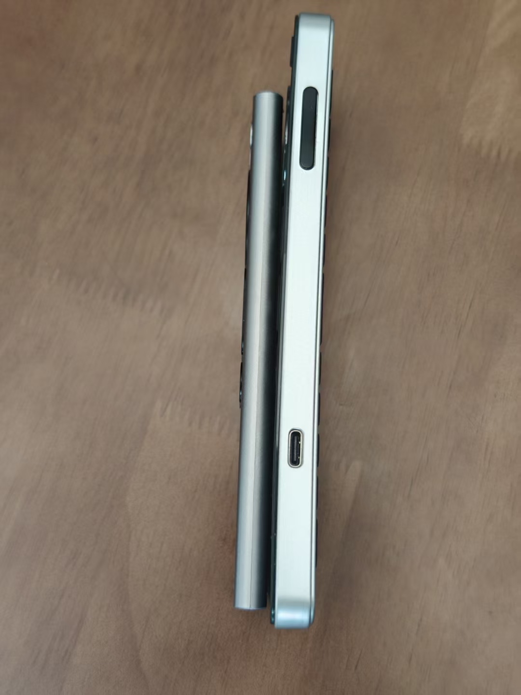
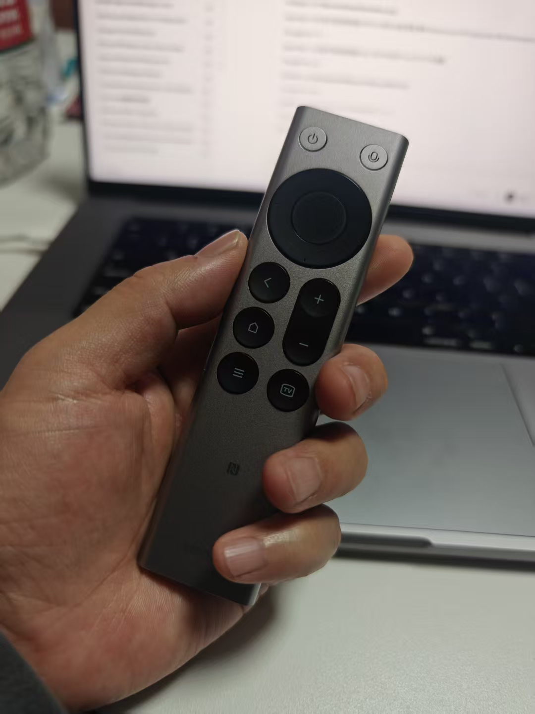
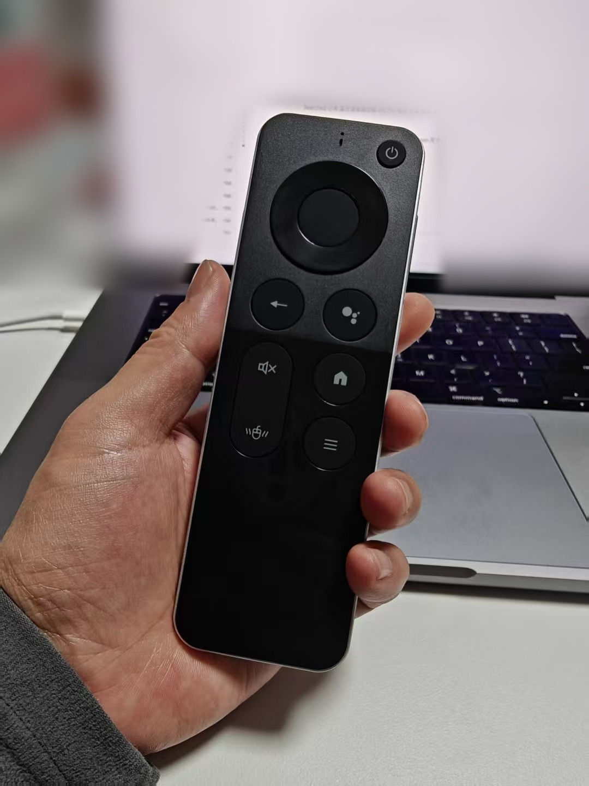
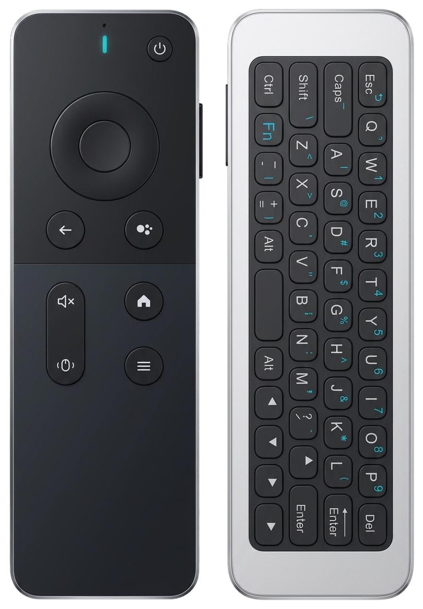

# 小米蓝牙遥控器 2 Pro vs T1 飞鼠键盘遥控器：在 Mac 上当无线语音输入器该选谁？

搭配 [Remote Buddy（遥控搭子）](../README.md) 使用时，电视遥控器可以变成 Mac 的无线语音输入与桌面快捷控制器。在当前已完成完整适配的型号中，最容易被放在一起对比的，就是口碑稳定的**小米蓝牙遥控器 2 Pro（型号 `RC003`）**，以及近期完成适配、功能极其丰富的公版**T1 飞鼠键盘语音遥控器（`T1-Remote` 及同方案兼容款）**。

两款遥控器都能通过标准蓝牙低功耗音频协议（ATVV v1.0，16 kHz IMA-ADPCM）把清晰人声实时送入微信输入法、豆包、Voice Buddy（语音搭子）、macOS 听写等语音输入工具，但它们在**价格、体积手感、按键与接口布局、附加功能**，尤其是**语音按键的触发与交互方式**上差异非常明显。

---

更多型号、是否需要长按及购买入口见[遥控器设备指南](supported-devices.md)。下文约 50 元等历史价格不是实时询价；当前核验日期及来源以设备指南为准。

## 一、外观总览与直观对比

把两台真机平放在桌面对比，风格差异一眼就能看出来：

  

- **小米蓝牙遥控器 2 Pro（左）**：银灰色金属拉丝质感单面长条机身，方正利落，按键集中紧凑（顶部电源与麦克风，中间五向圆盘，下方返回/主页/菜单/TV 与正面音量 `+`/`-` 键）。
- **T1 飞鼠键盘遥控器（右）**：圆润边框配深色镜面前面板，整体更宽更长；正面保留电源、方向盘、返回、四点语音键、静音/飞鼠键以及主页与菜单键，**把音量 `+`/`-` 键与 Type-C 接口移到了右侧边框上**，背面则是完整的 QWERTY 迷你键盘。

  

从斜俯视角度也能看到充电接口布局的不同：小米 2 Pro 的 **Type-C 接口位于机身底端**，而 T1 的 **Type-C 接口与侧边音量按键都在右侧边**。

---

## 二、核心规格横向对比

| 对比维度 | 小米蓝牙遥控器 2 Pro（`RC003`） | T1 飞鼠键盘语音遥控器（`T1-Remote`） |
| --- | --- | --- |
| **参考价格** | 日常 **90 多元**，大促特价常见 **60 多元** | 淘宝常年 **50 元左右** |
| **参考尺寸与重量** | 约 **138 × 35 × 8.9 mm**，重约 **61 g**（更窄更薄更紧凑） | 约 **160 × 50 × 10 mm**，重约 **62 g**（更宽更长、略厚约 1 mm） |
| **供电与充电** | 内置 **300mAh** 锂电池，底部 **Type-C** 充电 | 内置 **400mAh** 锂电池，右侧边 **Type-C** 充电 |
| **蓝牙语音协议** | ATVV v1.0 / 16 kHz IMA-ADPCM（`highFirst`） | ATVV v1.0 / 16 kHz IMA-ADPCM（`highFirst`） |
| **语音触发模式** | **按住说话，松手即停**（对讲机式） | **按一下松开持续说话，再按一下结束**（开关式） |
| **单次持续时长** | **约 60 秒上限**，且需全程按住语音键，适合短句与中短段落 | 不会在松手或 60 秒处断流（作者样机实测可连续口述近 2 分钟，Host 每 10 秒 `MIC_EXTEND` 保活、最长约 5 分钟保护上限） |
| **输入工具兼容性** | 可适配长按或点按触发的输入工具；**遥控器实体语音键仍须持续按住** | Remote Buddy 期间代为全程保持系统 Fn 按下或自动转双点按，兼容长按与点按两种工具 |
| **正面按键自定义** | 全部正面常规按键可映射（方向/OK/返回/主页/菜单/音量/TV 等） | **返回/主页/菜单/音量+/音量-/静音/电源** 等 7 个独立按键可自定义映射，并抑制原生 Spotlight 误触发；**方向键与确认键保持原生直通**，确保不劫持背面全键盘的方向键与 Enter |
| **空中飞鼠** | 无 | **内置 6 轴陀螺仪飞鼠**，原生直通 macOS 光标移动与左键点击 |
| **物理键盘** | 无 | **背面约 45 键 QWERTY 迷你全键盘**（含 Esc/Ctrl/Alt/Fn/方向键/Enter/Del），原生直通输入且带正反防误触 |
| **连接方式与注意** | 蓝牙直连 Mac（长按主菜单+返回等配对）；NFC 投屏在 Mac 无用 | 支持蓝牙 / 2.4G 双模，**接入 Remote Buddy 必须用蓝牙直连**（长按 `Home + Back` 配对），2.4G 接收器模式不支持 ATVV 语音链路 |

> 注：两款的尺寸与电池容量来自公开商品参数整理，不同贴牌批次的 T1 兼容版在机身材质、重量或按键丝印上可能存在细微差别。

---

## 三、分项深度对比

### 1. 价格与性价比

- **T1 遥控器（约 50 元）**：日常稳价在 50 元上下，不需要蹲大促就有极高性价比，而且一份价钱买到了“语音手柄 + 空中飞鼠 + 迷你无线键盘”三套硬件能力。
- **小米 2 Pro（日常 90 多元 / 特价 60 多元）**：如果不急着入手、蹲到 60 多元特价时非常值，小米在模具质感、按键清脆度和一致性上很有优势；按 90 多元日常价入手，则主要是为品牌做工和更精致的小巧手感买单。

### 2. 体积、厚度与真实握持手感

虽然两款遥控器实称重量相近（都在 **61~62 g** 左右）且都使用 **Type-C 充电**，但实际拿在手里的体量差别非常直观：

  
  

- **叠放投影与厚度对比**：小米 2 Pro 无论是长度还是宽度都明显小一圈；从侧面贴合也能看出，小米机身整体更纤薄圆润，而 T1 为了给背面全键盘和更大的 400mAh 电池留出结构空间，侧面更平直厚实一些（右侧边可以看到黑色音量摇杆和下方的 Type-C 接口）。

| 单手握持：小米 2 Pro | 单手握持：T1 遥控器 |
| :---: | :---: |
|  |  |
| 细窄贴手，三指轻松包住机身，大拇指自然覆盖所有正面按键 | 宽度刚好填满掌心，握持感饱满扎实，更适合稳定抓握与按键 |

### 3. 功能扩展性：极简桌面搭档 vs 双面全能远控

- **小米 2 Pro 是纯粹的“单面控制 + 语音麦克风”**
  如果你平时就坐在电脑桌前，左手拿遥控器说话，右手本来就放着鼠标和机械键盘，你其实并不需要飞鼠或背面迷你键盘。小米大颗粒、低阻力的正面独立按键，用来映射“回车、删除、全局快捷键、应用切换、音量控制”反而干脆直接。

- **T1 是真正的“离开桌面也能搞定一切”**
  T1 最大的杀手锏在于正反双面结构（背面全键盘布局见下示意图）：

  

  一旦到了 Mac 接大屏电视/显示器、躺在沙发或床上语音口述、会议室投屏演示等场景，T1 的优势会立刻放大：
  1. **正面控制键映射**：在 Remote Buddy 中支持将返回、主页、菜单、静音、音量±、电源这 7 颗不与背面键盘冲突的正面按键自定义为单击/双击/长按和连发（方向键与 OK 保持原生直通，多个 HID 报文通道互相独立跟踪）。
  2. **空中飞鼠**：按一下飞鼠键即可晃动手腕直接控制 Mac 光标并左键点击，切焦点、点发送、关弹窗不必起身找鼠标。
  3. **背面 QWERTY 迷你全键盘**：语音识别遇到生僻人名、代码术语、密码输入或末尾删改时，直接翻过机身用双手拇指敲几个字母、`Backspace`、`Enter`、`Esc`，并且硬件自带正反面防误触；在 Remote Buddy 下采用非独占打开方式，背面打字与空中飞鼠都会原生直通 macOS。

### 4. 核心差异：语音输入体验对比

在蓝牙音频层面，小米 2 Pro 和 T1 都走 ATVV v1.0 16 kHz IMA-ADPCM，收音清晰度和中文识别率处于同一水准。**真正决定使用节奏的，是两颗语音键截然不同的硬件机制**：

#### 小米 2 Pro：经典“按住说话，松手即停”（单次约 60 秒限制）
- **硬件工作方式**：按下语音键开始录音，手指一松开立刻停止收音并上屏；同时小米遥控器存在单次约 **60 秒** 的连续录音时长限制。
- **使用感受**：最符合微信发语音与对讲机的直觉习惯，零学习成本。日常聊短句、发几句话或高频给 AI 发指令时干净利落，不会出现忘记关麦的情况。
- **短板**：受限于单次 **60 秒上限** 和物理长按需求，如果要一口气口述一两分钟的长文章、周报或大段文字，不仅大拇指一直按住容易累，还会碰到 60 秒时长限制。

#### T1 遥控器：开关式“按一下开始，再按一下结束”
- **硬件工作方式**：在作者实机样本上，T1 第一次按下并**松开**语音键后，硬件**不会停播**，而是持续发送语音流；Remote Buddy 每 10 秒发送 `ATVV MIC_EXTEND` 维持会话（作者样机实测可稳定连续输出近 2 分钟，Host 侧设约 5 分钟保活上限与 5 秒关麦超时兜底；不同贴牌批次表现仍以实测为准）。只有当你说完后**再次按下语音键**，Remote Buddy 才会下发 `MIC_CLOSE` 结束录音并送出尾音。
- **长按型与点按型输入工具通吃**：不用担心“某些输入法要求一直按住 Fn 才识别，T1 第一次松手不就断了吗？”——在 Remote Buddy 中，从你第一下按下 T1 语音键起，一直到你第二下按完且语音排空结束为止，**程序会在系统端替你全程虚拟按住 `Fn` 键**（如果选的是点按模式工具，则自动转为首尾两次点按 `Fn`）。因此无论目标软件只支持“长按 Fn”还是支持“点按切换”，都能做到**按一下就解放双手说长段话，讲完再按一下立刻上屏**。
- **使用感受与注意**：非常省手指，适合大段连续口述；但心智上要习惯“结束时再按一下”的开关逻辑，如果是每句只有两三秒的零碎高频短对话，比小米多一次按键动作。

---

## 四、总结与选购建议

| 如果你更看重…… | 推荐选择 |
| --- | --- |
| 预算有限（~50 元稳价），追求把能给的功能一次给全 | **T1 飞鼠键盘语音遥控器** |
| 经常大段连续口述超过 1 分钟的内容，不想受 60 秒限制也不想一直按着键不放 | **T1 飞鼠键盘语音遥控器** |
| 有离开电脑桌（沙发/床上/大屏/投影）隔空移动鼠标、顺手敲几下字母或回车的需要 | **T1 飞鼠键盘语音遥控器** |
| 长期坐在电脑前高频短句语音输入，“按住说、松手停”最顺手且不用记着关麦 | **小米蓝牙遥控器 2 Pro** |
| 更喜欢轻薄细窄的单面质感、更舒服的盲操大按键（尤其趁 60 多元特价入手） | **小米蓝牙遥控器 2 Pro** |

简而言之：**小米蓝牙遥控器 2 Pro 是细腻顺手的“桌面短平快语音伴侣”，而 50 元左右的 T1 则是把长段免手按口述、空中飞鼠和物理小键盘一次凑齐的“高性价比全能远控外设”。**
